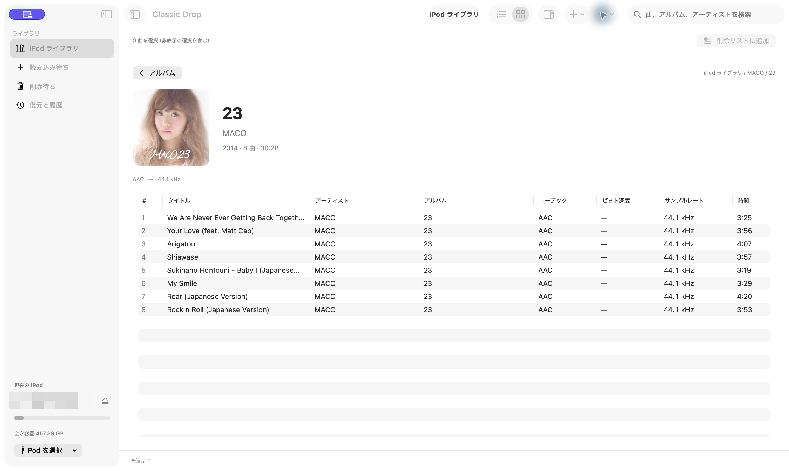
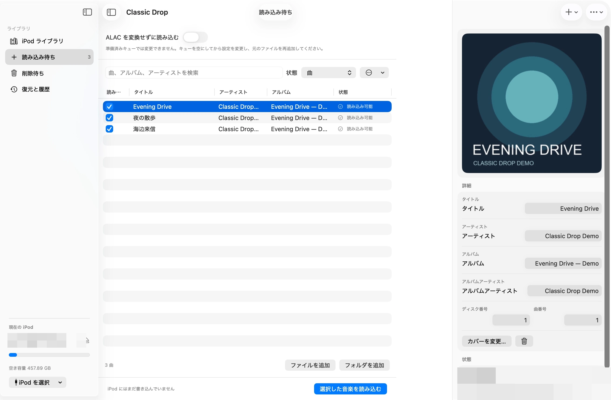
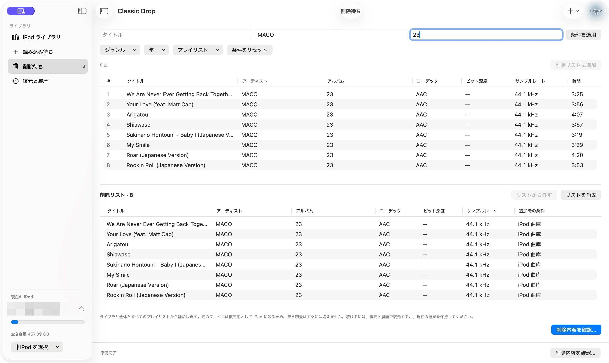

# Classic Drop

[English](README.md) | [简体中文](README.zh-CN.md) | 日本語

[](#動作環境)
[](#開発)
[](LICENSE)
[](#開発状況)

Classic Drop は、**Apple 純正ファームウェアの iPod Classic** 向けに作られた、macOS ネイティブの音楽インポートアプリです。既存の iPod ライブラリに選んだ音楽を追加でき、従来の iTunes/iTools のように、時間がかかり既存の内容を削除する可能性のあるライブラリ全体の照合を必要としません。

iPod に入っている音楽を残したまま、アルバムを数枚すばやく追加したい方に向けて設計されています。既存のデータベース情報、アルバムアートワーク、メタデータの保持を重視しています。

> **重要：** Classic Drop は実験段階のソフトウェアです。初めて書き込む前に、iPod 全体をバックアップしてください。SSD に換装した A1238 iPod Classic でテストされていますが、ほかのハードウェア構成や破損したデータベースは十分に検証されていません。

## 主な機能

- **追加型インポート：** 選択した曲を追加します。通常のインポートで既存の曲を削除することはありません。
- **Apple データベース対応：** iOpenPod のデータベース層を通じて、純正ファームウェアの `iTunesDB` と `ArtworkDB` を読み書きします。
- **メタデータ編集：** インポート前にタイトル、アーティスト、アルバム、アルバムアーティスト、ディスク番号、トラック番号を確認・編集できます。
- **アートワークの保持：** 埋め込み画像、または同じフォルダの `cover`、`folder`、`front` 画像を使い、デバイスに対応した形式で書き込みます。
- **既存ライブラリの閲覧：** iPod のライブラリを変更せずに閲覧し、曲名、アーティスト、アルバムで検索できます。
- **アルバム表示：** 曲一覧とアートワークのグリッドを切り替えられます。アルバムをダブルクリックすると、収録曲、年、再生時間、アートワークを確認できます。
- **重複候補の確認：** 重複の可能性がある曲は初期状態で選択されず、インポート前に確認できます。
- **復元可能な削除：** 専用ワークスペースで対象の音楽トラックを確認して削除できます。復元用データは iPod 上に保持されます。
- **復元機能：** 書き込みが中断された場合は復元記録を保持し、アプリ内に復元操作を表示します。
- **macOS ワークスペース：** サイドバー、ネイティブのツールバー、折りたたみ式アートワークインスペクタ、システム配色を使用します。表示言語は英語、簡体字中国語、日本語に対応しています。
- **読み取り専用のデバイス検出：** 接続、検出、閲覧によって iPod が変更されることはありません。

## スクリーンショット

以下は、ネイティブ SwiftUI アプリを日本語で表示した実際のスクリーンショットです。[英語](README.md#screenshots)と[簡体字中国語](README.zh-CN.md#界面截图)の README では、同じワークスペースをそれぞれの言語で掲載しています。デバイス名と個人用パスには粗いモザイクをかけています。インポート準備には生成したデモ音声を使い、撮影中にインポート・削除・復元は実行していません。

### アルバムライブラリとアートワークインスペクタ

アルバムアートワークを閲覧し、ライブラリの横でメタデータを確認できます。


### アルバム詳細と曲一覧

アルバムを開くと、アートワーク、年、再生時間、収録曲を確認できます。



### インポート準備とメタデータ編集

インポートを実行する前に、選択したファイル、アートワーク、編集可能なタグ、元の ALAC を変換せずに読み込む設定を確認できます。



### 削除リストと絞り込み

既存の音楽を絞り込み、削除リストに追加して、デバイスへの変更を確定する前に確認できます。



## 対象範囲と対象外の機能

現在の Classic Drop は、次の環境と用途を対象としています。

- macOS を搭載したコンピュータ。
- Apple 純正ファームウェアの iPod Classic。
- ファイルシステム経由でアクセスでき、iTunes データベースを読み取れるデバイス。
- 音楽のインポート、アートワークとメタデータの処理、明示的に選択した音楽トラックの復元可能な削除。

次の項目は現在の対象外です。

- Rockbox で管理されているデバイス。
- iPod touch、iPhone、iPod shuffle。
- 完全削除やミラー同期による自動削除。
- ポッドキャスト、オーディオブック、ビデオなど、音楽以外のメディアの削除。
- Finder/iTunes によるデバイス管理全体の代替。
- クラウド音楽サービスやオンラインでのメタデータ検索。

インポートは常に追加のみを行います。既存の音楽を削除するには、専用の **To Remove（削除対象）** ワークスペースで、対象の曲と影響を受けるプレイリストを確認してから確定します。削除した曲は各プレイリストからも取り除かれますが、元のデータベースとメディアファイルは復元のために iPod 上に保持されます。復元用データが引き続き容量を使用するため、削除してもその分の空き容量はすぐには増えません。削除完了後は、その削除を復元するか、現在のライブラリを保持することを明示的に選ぶと、再びインポートや削除を行えます。保持を選ぶと、その削除とそれ以前の操作は自動復元の選択肢から外れますが、復元用ファイルは残ります。インポートは連続して実行でき、それぞれ復元できます。復元には元の iPod とコンピュータ上の操作履歴が必要です。詳細は [ADR-0177](docs/adr/0177-classic-drop-recoverable-track-removal.md) と [ADR-0181](docs/adr/0181-classic-drop-accepted-removal-baseline.md) を参照してください。

## 動作環境

- macOS 12.3 以降。
- 開発用ビルドには Python 3.12。
- マウント済みで、ファイルシステム経由でアクセスできる Apple iPod Classic。
- 開発作業には `uv`。
- 変換が必要な形式をインポートする場合は、`PATH` 上の `ffmpeg` と `ffprobe`。

ネイティブアプリは、接続後に対応する iPod Classic のボリュームを自動でマウントします。
Finder で先に開く必要はありません。同時に別のアプリから iPod のデータベースへ書き込まないでください。
管理アプリは一度に一つだけ使用し、接続を外す前に安全に取り出してください。

## 開発版のインストール

```shell
git clone https://github.com/zorroforever/classic-drop.git
cd classic-drop
uv sync --locked
```

現在は主にソースコードとして配布されています。署名・公証済みの正式なインストーラはまだ公開されていません。

## macOS アプリのビルド

Liquid Glass の新しい UI は SwiftUI を使用し、開発ビルドには GUI のない
Python helper が含まれます。次のコマンドでネイティブアプリを起動します。

```shell
uv run python scripts/build_classic_drop_native.py
open "dist/native/Classic Drop.app"
```

ビルド設定、プロトコル、実機検証の制限は[ネイティブアプリの文書](docs/classic-drop-native.md)を参照してください。
`uv run classic-drop` と次のビルドは、比較用に保持した Qt の画面を起動します。

```shell
uv sync --locked
uv run pyinstaller --clean --noconfirm packaging/classic-drop.spec
open "dist/Classic Drop.app"
```

現在の開発マシンでビルドすると、Apple Silicon 向けのアプリが生成されます。ツールバーとアルバムのプレースホルダーに必要な SVG アイコンもアプリに含まれます。

## 基本的な使い方

1. iPod を接続します。ネイティブアプリは対応するボリュームを自動で検出・マウントします。
2. Classic Drop を開きます。デバイスが表示されない場合は **Refresh（更新）** を選びます。
3. iPod を選択します。**iPod Library（iPod ライブラリ）** ワークスペースは読み取り専用で、曲一覧またはアルバム表示で検索できます。ワークスペースの切り替えにはサイドバーを使います。
4. **To Import（インポート対象）** を開き、ファイルまたはフォルダを追加して、検出されたメタデータとアートワークを確認します。
5. 不要な曲や重複する曲の選択を外し、**Import Selected（選択した曲をインポート）** を明示的に実行します。
6. 検証が完了するまで待ち、アプリの取り出し操作を使ってから接続を外します。

デバイスの検出・選択、ライブラリの閲覧、検索、アルバムの閲覧では、実際の書き込みは行われません。新しい音楽を iPod に書き込むのは、変更を確定する操作です。

## 開発

プロジェクトは `src/` レイアウトと、依存関係をロックした `uv` 環境を使用します。

```shell
uv sync --locked
uv run pytest -q tests/classic_drop tests/iOpenPod/GUI/presentation/test_icons.py
uv run ruff check src/classic_drop tests/classic_drop packaging/classic-drop.spec
uv run mypy src/classic_drop
```

Classic Drop の主な実装は次のように分かれています。

- `src/classic_drop/engine.py`：追加型インポートと復元処理の調整。
- `src/classic_drop/worker.py`：デバイス・メディア操作の逐次実行。
- `src/classic_drop/window.py`：Qt アプリケーションウィンドウと、インポート・ライブラリの操作フロー。
- `src/classic_drop/albums.py`：アルバムのグループ化、アートワークカード、アルバム表示。
- `src/classic_drop/removal.py`、`removal_view.py`、`removal_review.py`：音楽の絞り込み、削除対象の選択、確認。
- `src/classic_drop/shell.py`、`library_view.py`、`import_view.py`、`presentation.py`：ワークスペースの構成、各ビュー、システム配色を使った共通表示。
- `tests/classic_drop/`：エンジン、メディア、ワーカースレッド、UI の回帰テスト。

基盤となる iPod データベースとストレージのコードは、このリポジトリに含まれる iOpenPod プロジェクトが提供しています。背景については、[`CLASSIC_DROP.md`](CLASSIC_DROP.md)、[`docs/adr/`](docs/adr/) のアーキテクチャ決定記録、および上流プロジェクトへの謝辞を参照してください。

## デバイスの安全性

実機でテストする前に、次の点を確認してください。

1. iPod 全体をバックアップする。
2. macOS で正常にマウントと取り出しができることを確認する。
3. 同じデータベースに書き込む可能性がある Finder/iTunes などの管理アプリを閉じる。
4. 最初は少数の曲をインポートし、iPod 上で確認してから大量の曲を追加する。
5. Classic Drop が完了を報告するか、復元操作を表示するまで、デバイスを接続したままにする。

Classic Drop は、破損したデータベースやほかのアプリが同時に変更したデータベースを修復できるとは保証しません。復元記録は障害時の対処に役立ちますが、バックアップの代わりにはなりません。

## 開発状況

Classic Drop は Alpha 段階で、実機での利用を重視して開発されています。現在、動作が確認されている構成は、SSD に換装した A1238 iPod Classic、Apple 純正ファームウェア、読み取り可能な iTunes データベース、macOS の組み合わせです。ほかの iPod 世代、Intel Mac 向けビルド、リリースへの署名、より幅広いハードウェアのテストデータは、引き続き検証が必要です。

不具合を報告する際は、次の情報を含めてください。

- iPod のモデル番号とファームウェア情報。
- ストレージを換装しているかどうか。
- macOS のバージョンと CPU アーキテクチャ。
- Finder で iPod がマウントされたか、ディスクとして使用する設定が有効か。
- 実行した操作と、画面に表示されたエラーメッセージ。
- **More → Show backups and logs（その他 → バックアップとログを表示）** から確認できる関連ログ。

ログを公開する前に、個人の音楽ファイルのパスとデバイスのシリアル番号を取り除いてください。

## ライセンスと謝辞

Classic Drop は [GNU General Public License v3.0 以降](LICENSE) で公開されています。iOpenPod 2.0.15 のデータベース、ストレージ、アプリケーションの各コンポーネントを再利用しています。帰属表示とサードパーティのライセンス情報は、[`ACKNOWLEDGEMENTS.md`](ACKNOWLEDGEMENTS.md)、[`COPYING.md`](COPYING.md)、[`packaging/third-party/`](packaging/third-party/) を参照してください。

## ロードマップ

- 署名・公証済み macOS リリースの配布。
- A1238 と iPod Classic のテストデータの拡充。
- 空き容量が少ないデバイス向けのインポートプレビューの改善。
- リリース情報の充実と、任意で利用できるオンラインアートワーク検索。
