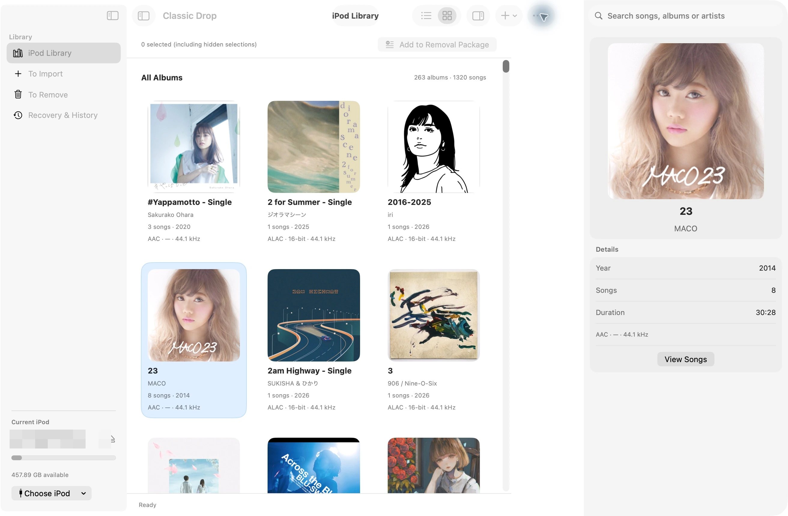
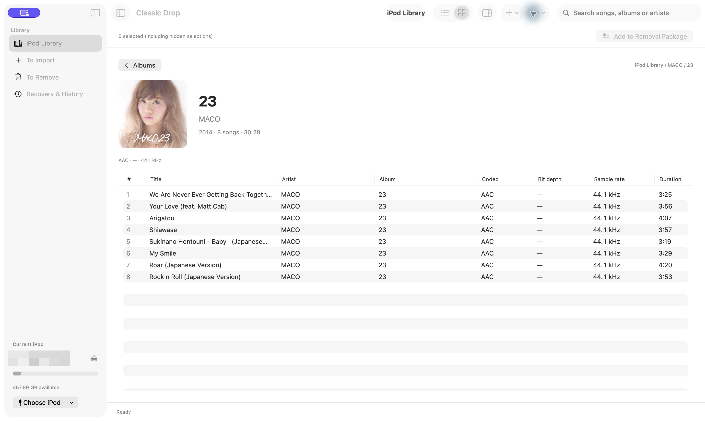
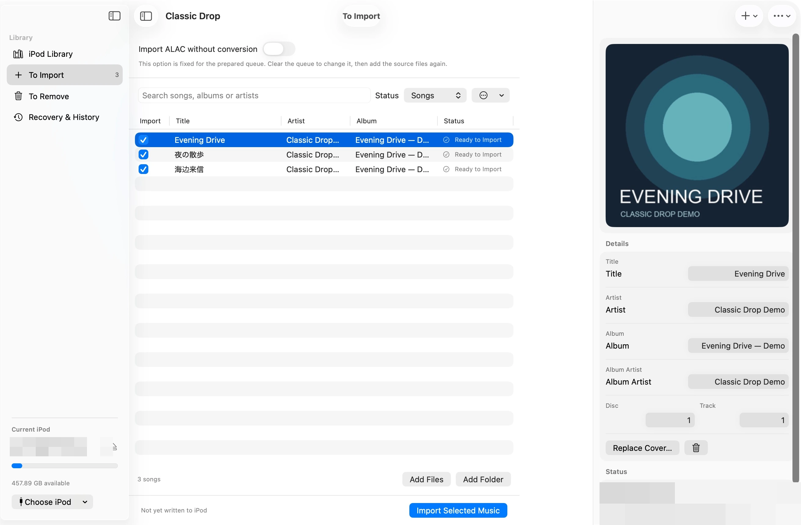
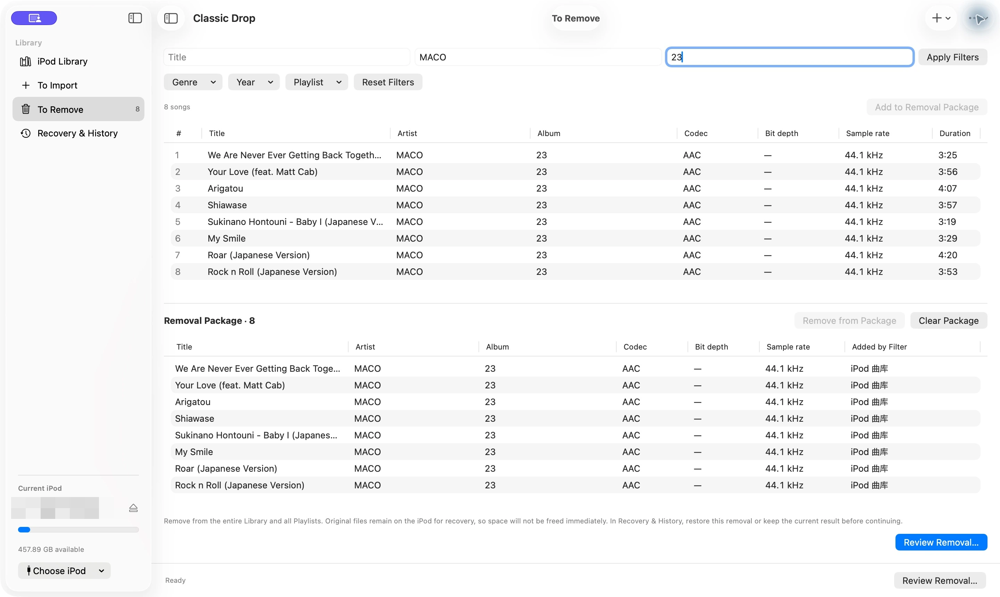

# Classic Drop

English | [简体中文](README.zh-CN.md) | [日本語](README.ja.md)

[](#requirements)
[](#development)
[](LICENSE)
[](#status)

Classic Drop is a native macOS importer for Apple-stock-firmware **iPod Classic** devices. It adds selected music to an existing iPod library without performing the slow, destructive-style full reconciliation associated with legacy iTunes/iTools workflows.

It is designed for people who want to keep the music already on an iPod, add a few albums quickly, preserve the device's existing database data, and keep album artwork and metadata intact.

> **Important:** Classic Drop is experimental software. Back up the iPod before the first write. The application has been tested against an A1238 iPod Classic with an SSD, but hardware variations and damaged databases are not fully covered.

## Highlights

- **Incremental import:** appends selected tracks and does not remove existing songs during a normal import.
- **Apple database support:** reads and writes the stock-firmware `iTunesDB` and `ArtworkDB` through the iOpenPod database layer.
- **Metadata editing:** review and edit title, artist, album, album artist, disc number, and track number before import.
- **Artwork preservation:** uses embedded artwork or nearby `cover`, `folder`, and `front` images, then writes device-compatible artwork.
- **Existing-library browser:** inspect the current iPod library without editing it; search by track, artist, or album.
- **Album view:** switch between a track list and an artwork grid, then double-click an album to inspect its tracks, year, duration, and cover.
- **Duplicate-aware queue:** likely duplicates are unchecked by default and can be reviewed before import.
- **Recoverable removal:** review and explicitly remove selected music tracks in a separate workspace, with device-side recovery data retained for restoration.
- **Recovery:** interrupted writes keep a recovery record and expose a restore action in the app.
- **macOS workspaces:** sidebar navigation, a native toolbar, a collapsible artwork inspector, and system palette support in English, Simplified Chinese, and Japanese.
- **Read-only device discovery:** connecting, discovering, and browsing do not modify the iPod.

## Screenshots

Actual screenshots of the native SwiftUI app, with English UI below. The [Chinese](README.zh-CN.md#界面截图) and [Japanese](README.ja.md#スクリーンショット) READMEs show the same workspaces in their respective languages. Device names and personal paths are covered with coarse mosaic. Import preparation uses generated demo audio; no import, removal, or restore was executed for these screenshots.

### Album library and artwork inspector

Browse album covers and inspect album metadata alongside the library.



### Album details and track list

Open an album to view its artwork, year, duration, and individual tracks.



### Import preparation and metadata editing

Review selected files, artwork, editable tags, and the original-ALAC option before explicitly importing.



### Removal package and filters

Filter existing music and stage a Removal Package for review before confirming any device changes.



## Scope and non-goals

Classic Drop currently targets:

- macOS hosts;
- Apple-stock-firmware iPod Classic devices;
- filesystem-accessible devices with a readable iTunes database;
- music import, artwork/metadata handling, and explicit recoverable music-track removal.

The following are intentionally out of scope:

- Rockbox-managed devices;
- iPod touch, iPhone, or iPod shuffle;
- permanent deletion or automatic mirror-based deletion;
- removing podcasts, audiobooks, videos, or other non-music media;
- replacing Finder/iTunes device management;
- cloud music services or online metadata lookup.

An import is append-only. Removing existing music is a separate, explicit workflow in **To Remove**: review the selected tracks and affected playlists before confirming. Removal also removes those tracks from playlists, while retaining original database and media files on the iPod for recovery. Recovery data continues to occupy device capacity, so removal does not immediately free that space. After a completed removal, restore it or explicitly keep the current library before another import or removal. Keeping it retires that removal and earlier operations as automatic restore choices, while retaining recovery files. Consecutive imports remain allowed and individually recoverable. Restoration requires the original iPod and the local operation history. See [ADR-0177](docs/adr/0177-classic-drop-recoverable-track-removal.md) and [ADR-0181](docs/adr/0181-classic-drop-accepted-removal-baseline.md).

## Requirements

- macOS 12.3 or later;
- Python 3.12 for development builds;
- a mounted, filesystem-accessible Apple iPod Classic;
- `uv` for the development workflow;
- `ffmpeg` and `ffprobe` on `PATH` when importing formats that need conversion.

The native app automatically mounts supported iPod Classic volumes after connection;
Finder is not required for that workflow. Avoid running another application that is
writing the iPod database at the same time. Use one manager at a time and safely
eject before disconnecting.

## Install a development build

```shell
git clone https://github.com/zorroforever/classic-drop.git
cd classic-drop
uv sync --locked
```

The current repository is primarily a source distribution. A signed/notarized release installer is not published yet.

## Build the macOS application

The approved SwiftUI shell has a separate development build with a bundled
headless helper. It provides the album grid/detail UI and persistent preparation
and write progress:

```shell
uv run python scripts/build_classic_drop_native.py
open "dist/native/Classic Drop.app"
```

See [native build and verification](docs/classic-drop-native.md) for build options,
protocol details and pending platform/hardware acceptance. The source command
`classic-drop` and the following build retain the Qt reference frontend:

```shell
uv sync --locked
uv run pyinstaller --clean --noconfirm packaging/classic-drop.spec
open "dist/Classic Drop.app"
```

The generated application is an Apple Silicon build when built on the current development machine. Packaging includes the bundled SVG glyph assets required by the toolbar and album placeholders.

## Typical workflow

1. Connect the iPod; the native app discovers and mounts supported volumes automatically.
2. Open Classic Drop and choose **Refresh** if the device is not listed.
3. Select the iPod. The **iPod Library** workspace is read-only and can be searched in list or album mode; use the sidebar to switch workspaces.
4. Open **To Import**, add files or a folder, and review the detected metadata and artwork.
5. Leave unwanted or duplicate tracks unchecked, then explicitly choose **Import Selected**.
6. Wait for verification to finish and use the app's eject action before disconnecting.

No physical write is performed by discovery, selection, library browsing, search, or album browsing. The commit step is the operation that publishes new music to the iPod.

## Development

The project uses a `src/` layout and a locked `uv` environment.

```shell
uv sync --locked
uv run pytest -q tests/classic_drop tests/iOpenPod/GUI/presentation/test_icons.py
uv run ruff check src/classic_drop tests/classic_drop packaging/classic-drop.spec
uv run mypy src/classic_drop
```

The Classic Drop implementation is split into:

- `src/classic_drop/engine.py` - append-only import and recovery orchestration;
- `src/classic_drop/worker.py` - serialized device/media operations;
- `src/classic_drop/window.py` - Qt application window and import/library workflows;
- `src/classic_drop/albums.py` - album grouping, artwork cards, and album presentation;
- `src/classic_drop/removal.py`, `removal_view.py`, and `removal_review.py` - music filters, removal selection, and confirmation;
- `src/classic_drop/shell.py`, `library_view.py`, `import_view.py`, and `presentation.py` - workspace shell, focused view widgets, and shared native-palette presentation;
- `tests/classic_drop/` - engine, media, worker, and UI regression tests.

The underlying iPod database and storage code is provided by the iOpenPod project in this repository. See [`CLASSIC_DROP.md`](CLASSIC_DROP.md), the architecture records in [`docs/adr/`](docs/adr/), and the upstream acknowledgements for additional context.

## Device safety

Before testing against real hardware:

1. make a complete backup of the iPod contents;
2. confirm the iPod can be mounted and ejected normally by macOS;
3. close Finder/iTunes-like managers that may write the same database;
4. start with a small import and verify it on the iPod before importing a large batch;
5. keep the device connected until Classic Drop reports completion or recovery availability.

Classic Drop never promises that a damaged or concurrently modified database can be repaired. Recovery records improve the failure path, but they are not a substitute for a backup.

## Status

Classic Drop is an alpha-quality, hardware-focused project. The current known-good scenario is an A1238 iPod Classic with an SSD, Apple stock firmware, a readable iTunes database, and a macOS host. More iPod generations, Intel macOS builds, release signing, and broader hardware fixtures still need validation.

Bug reports should include:

- iPod model number and firmware details;
- whether the storage was replaced;
- macOS version and CPU architecture;
- whether Finder mounted the iPod and whether disk use was enabled;
- the exact operation and any visible error text;
- relevant logs from **More -> Show backups and logs**.

Please remove personal music paths and serial numbers from logs before publishing them.

## License and acknowledgements

Classic Drop is licensed under the [GNU General Public License v3.0 or later](LICENSE). It reuses the iOpenPod 2.0.15 database, storage, and application components; see [`ACKNOWLEDGEMENTS.md`](ACKNOWLEDGEMENTS.md), [`COPYING.md`](COPYING.md), and [`packaging/third-party/`](packaging/third-party/) for attribution and third-party license information.

## Roadmap

- signed and notarized macOS release artifacts;
- wider A1238 and iPod Classic fixture coverage;
- safer import preview for low-space devices;
- richer release metadata and optional online artwork lookup.
